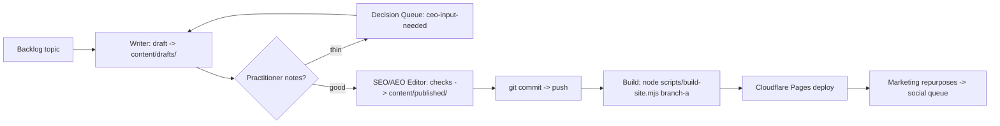

# Branch A Pipeline - How a Piece Goes From Backlog to Live

This is the Phase 2 operating loop. Claude Code drives steps 1-3 (thinking runs);
the build + deploy are mechanical.



## The Editor's publish gate

The SEO/AEO Editor may only move a draft to `published/` after its checklist in
`agents/seo-editor.md` passes. `{{AFF:...}}` placeholders stay in the markdown;
unmapped ones render as plain text - an unapproved program can never go live
with a live link.

Promoting a draft is also gated mechanically by `scripts/autonomy.mjs`: the
target path is canonicalised and confined to the allowlisted content roots, a
collision with an existing published page is refused rather than overwritten,
the 800-word floor and the scaffold check are re-run at promotion time, and a
second run is a no-op. A refusal is written to the activity feed with the
failing check named.

## Build

```bash
node scripts/build-site.mjs branch-a
```
Node 18+, zero npm dependencies. Output: `sites/branch-a/dist/`.

## Deploy (recommended free path)

Connect the repo to Cloudflare Pages via git integration: build command
`node scripts/build-site.mjs branch-a`, output dir `sites/branch-a/dist`.
Zero GitHub Actions minutes, unlimited bandwidth. The `publish.yml` workflow
is the fallback.

## AEO notes baked into the template

- Every post: direct 2-3 sentence answer within the first paragraph
- JSON-LD Article schema auto-generated at build
- Comparison tables -> quotable, parseable
- Canonical URLs use the domain in `sites/branch-a/site.json` (vantage-ars.co.za - set)