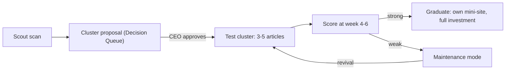

# Branch B - Opportunistic Affiliate Engine

Branch B is **not** locked to one niche. Scout scans continuously; each approved
idea becomes a lightweight test cluster; the Allocator's internal loop scores
clusters at 4-6 weeks. Winners graduate, losers archive. Nothing is deleted.

## Lifecycle

## Directory layout

- `TEMPLATE/` - the copyable scaffold; `scripts/new-cluster.mjs <name>` copies it
- `<cluster-name>/` - each live test cluster (own site.json, own dist/)
- `graduated/` - clusters promoted to full investment
- `archived/` - clusters in maintenance/retired (content kept, quota floored)

## Scoring (week 4-6, same formula as the Allocator)

- Traffic growth and click-through on the cluster's pages
- Conversion signals from any mapped affiliate programs
- Cluster score >= average of live clusters AND non-zero conversions -> graduate
- Cluster score bottom for 2 consecutive scoring runs -> maintenance
- A cluster whose metrics never arrived is `unknown`: it keeps `maintain-test`
  and the reason is logged. Absent analytics is not a failing score.
- **Archiving a cluster is allowed autonomously; killing Branch B itself is not**
  (that needs a CEO `kill-branch` approval, like every branch)